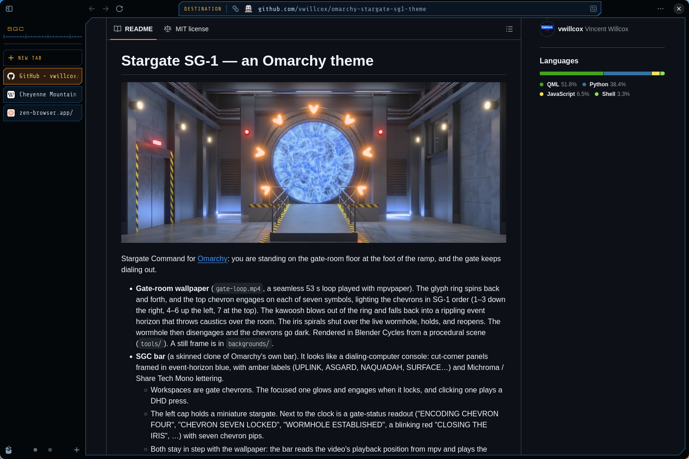
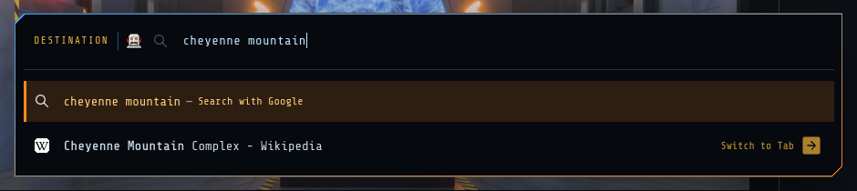
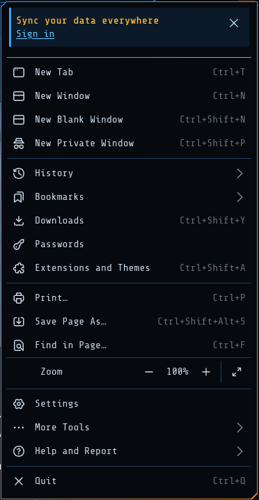

# SGate Theme for Zen Browser



[Zen Browser](https://zen-browser.app) as a Stargate Command dialing-computer
console: blue-black panels framed in event-horizon blue with two corners cut,
amber legends, chevron orange for whatever is selected, and Share Tech Mono /
Michroma lettering throughout.

- **Tabs** are cut-corner console panels: chevron orange when selected, amber
  on hover, dimmed while a tab hasn't loaded. "+ New Tab" is an empty slot
  with an amber legend.
- **The address bar** carries an amber DESTINATION legend, and opens in a
  2 px frame that runs from blue to orange.
- **Menus and panels** become a dark plate in the same blue-to-orange frame,
  with an orange bar beside the highlighted item.
- **Each page** sits in a framed console panel. In split view the focused
  pane's frame turns orange.
- **The space name** is a Michroma legend over a console scale.
- **Zen's own pages** (new tab, settings, add-ons, `about:config` and so on)
  get the same colours and lettering. Websites are left alone.
- **The fonts are bundled** (`fonts/`), so nothing needs installing.

| The address bar, open | The app menu |
|---|---|
|  |  |

Written against Zen 1.23 (Firefox 158). Zen's markup changes between
releases, so a part of the skin can lapse after a Zen update; please open an
issue if something looks off.

## Install

### With Sine

[Sine](https://github.com/CosmoCreeper/Sine) is a community mod manager for
Zen and other Firefox-based browsers. Once it is installed, open Sine's page
in Zen's settings, type `vwillcox/SGateTheme-Zen` into the
"add your own locally from a GitHub repo" box and press **Install**. Sine
keeps the mod up to date from this repository.

### By hand

1. In `about:config`, set `toolkit.legacyUserProfileCustomizations.stylesheets`
   to `true`.
2. Find your profile folder: `about:support` → **Profile Folder** → **Open
   Folder**. Make a `chrome` folder in it if there isn't one.
3. Clone this repository into that `chrome` folder:

   ```bash
   cd "<profile folder>/chrome"
   git clone https://github.com/vwillcox/SGateTheme-Zen
   ```

4. Add this line to the top of `chrome/userChrome.css` (create the file if it
   doesn't exist):

   ```css
   @import url("./SGateTheme-Zen/chrome.css");
   ```

   and this one to the top of `chrome/userContent.css`:

   ```css
   @import url("./SGateTheme-Zen/content.css");
   ```

5. Restart Zen. To update later, `git pull` in `chrome/SGateTheme-Zen` and
   restart Zen.

## Options

Each option is a Boolean preference. Sine shows them as checkboxes; by hand,
create them in `about:config`. They apply as soon as they change, with no
restart.

| Preference | When `true` |
|---|---|
| `mod.sgate.hide_spaces_switcher` | Hides the Spaces switcher at the foot of the sidebar |
| `mod.sgate.hide_space_name` | Hides the space name above the tabs |
| `mod.sgate.hide_destination` | Hides the DESTINATION legend in the address bar |
| `mod.sgate.plain_pages` | Shows web pages without the console frame |
| `mod.sgate.system_fonts` | Uses Zen's own fonts instead of the console lettering |

## Uninstall

In Sine, remove the mod. By hand, delete the two `@import` lines and the
`chrome/SGateTheme-Zen` folder, then restart Zen.

## Also on Omarchy

This skin is part of the
[Stargate SG-1 theme for Omarchy](https://github.com/vwillcox/omarchy-stargate-sg1-theme),
which adds an animated gate-room wallpaper and an SGC dialing-computer bar,
and switches Zen to this skin along with the rest of the desktop.

## License and credits

MIT licensed; see `LICENSE`.

Fonts: [Michroma](https://fonts.google.com/specimen/Michroma) and
[Share Tech Mono](https://fonts.google.com/specimen/Share+Tech+Mono), both
under the SIL Open Font License (`fonts/OFL-*.txt`).

Stargate SG-1 is a trademark of MGM. This is a non-commercial fan theme, not
affiliated with or endorsed by MGM, and it uses nothing taken from the show.
